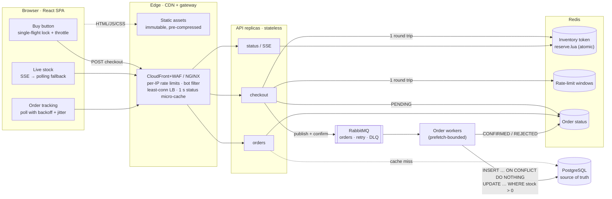
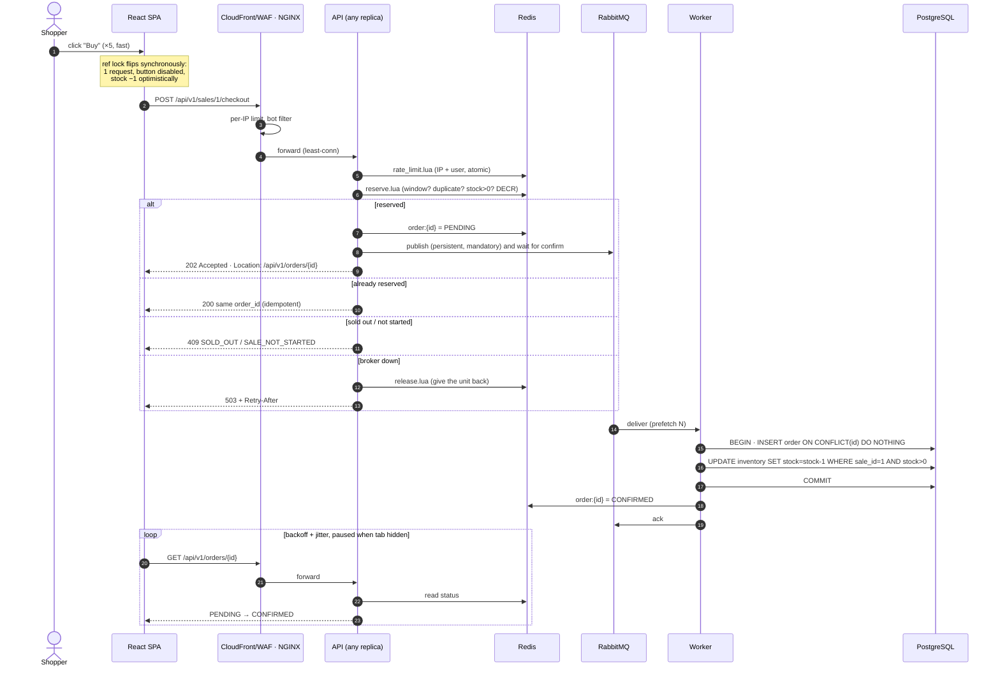
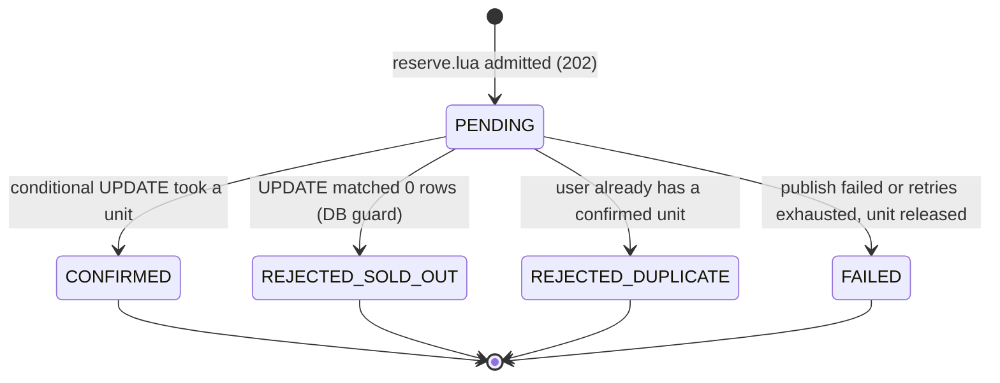
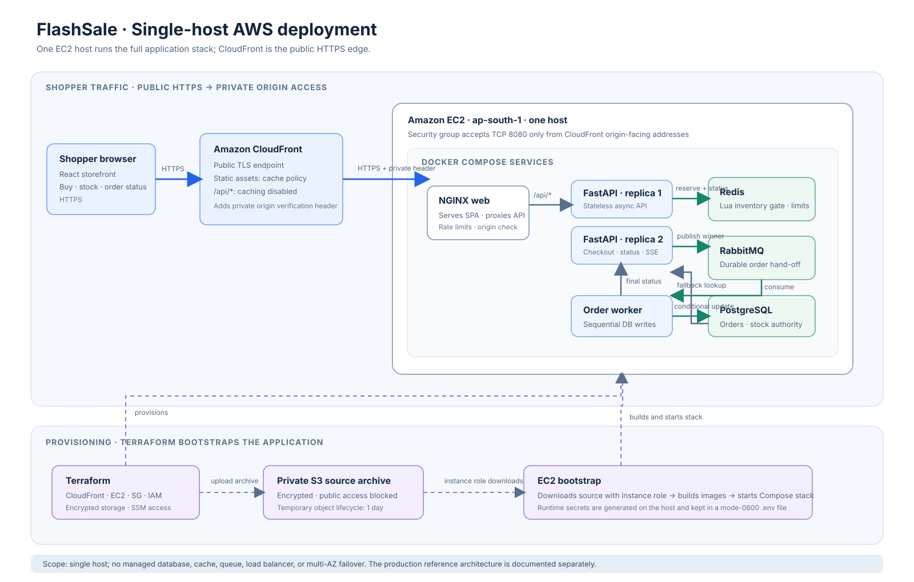
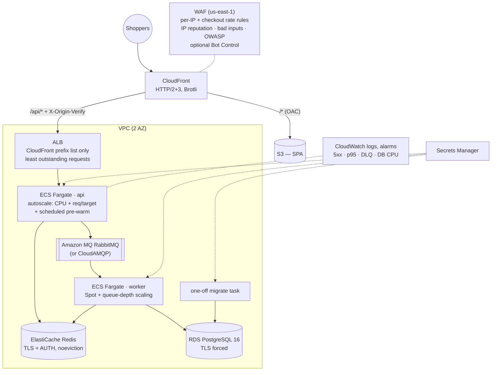

# FlashSale — flash-sale checkout reference architecture

A production-shaped reference implementation of the **festival flash-sale case study**: a limited
batch of **500 smartphones** goes live at **8:00 PM**, and **100,000+ checkout requests** arrive in
the first 10 seconds. Earlier trial runs suffered high latency, row-lock timeouts, API timeouts and
an **oversell of 540/500**. This repository addresses the case study's main failure modes with:

- an atomic Redis reservation and conditional database update to prevent overselling;
- **every request gets a fast, deliberate answer** (`202` reserved, `200` already yours, `409` sold
  out, `429` slow down) instead of a timeout;
- a queue and worker that keep the checkout request path separate from order persistence.

**Stack:** React 18 + TypeScript (Vite) · FastAPI (async) · Redis (Lua) · RabbitMQ · PostgreSQL ·
NGINX · Docker Compose · Terraform on AWS (ECS Fargate, ALB, CloudFront + WAF, RDS, ElastiCache,
Amazon MQ).

> **Measured locally** (one laptop, 6 × 1-vCPU API containers):
> 5,000 users at 1,500 checkout req/s + 500 status polls/s → **500/500 sold, 0 oversold, 0 errors,
> checkout p50 2.5 ms / p95 52 ms**, status p95 0.8 ms. Frontend: **177 KB** minified JS+CSS
> total, **56 KB** gzipped on first load. Details in [docs/performance.md](docs/performance.md).

---

## Contents

- [Quick start](#quick-start)
- [Architecture](#architecture)
- [How a checkout works](#how-a-checkout-works)
- [Why it can't oversell](#why-it-cant-oversell)
- [Frontend strategy](#frontend-strategy)
- [AWS deployment](#aws-deployment)
- [Testing & load testing](#testing--load-testing)
- [Case-study scorecard → implementation](#case-study-scorecard--implementation)
- [Repository layout](#repository-layout)
- [Documentation index](#documentation-index)

---

## Quick start

Prerequisites: Docker with Compose v2. Nothing else — no `.env` needed.

```bash
docker compose up -d          # or: make up
```

| What | URL |
|---|---|
| Storefront | http://localhost:8080 |
| Sale console (live invariants, reset) | http://localhost:8080/admin — key `local-admin-key` |
| API docs (OpenAPI) | http://localhost:8080/api/v1/docs |
| RabbitMQ management | http://localhost:15672 — `flash` / `flash` |
| Grafana (optional, `make observability`) | http://localhost:53000 |

The seed creates a sale that opens **2 minutes after start-up**. Sign up, watch the countdown, press
**Buy**. To replay the sale at any time:

```bash
make reset-sale STOCK=500 STARTS_IN=30     # or use the /admin page
```

Useful commands (`make help` lists all):

```bash
make test        # backend (in Docker, real Postgres/Redis/RabbitMQ) + frontend suites
make loadtest    # k6 spike: 5,000 users race for 500 units, then verify the database
make logs        # tail API + worker logs
make clean       # stop and delete all local data
```

Configuration: every variable has a working default. See [`.env.example`](.env.example) and
[docs/ENVIRONMENT.md](docs/ENVIRONMENT.md).

---

## Architecture



**Design in one paragraph.** The hot path never touches PostgreSQL. A checkout costs two Redis round
trips (an atomic multi-key rate limit, then a Lua script that checks the sale window, de-duplicates
the user and decrements the token) plus one RabbitMQ publish with a broker confirm. The API answers
`202 Accepted` with a tracking URL. Workers then persist each order in a short transaction whose
conditional `UPDATE` is the authoritative guard. Redis turns 100k requests into ≤500 database writes.
That removes the row-lock storm, the timeouts and, combined with the DB guard, the oversell. See
[docs/architecture.md](docs/architecture.md).

---

## How a checkout works





---

## Why it can't oversell

| # | Layer | Mechanism | Defends against |
|---|---|---|---|
| 1 | Redis gate | `reserve.lua` — check-and-`DECR` in one atomic script on Redis' single command thread | the read-then-write race that sold 540/500 |
| 2 | Conditional update | `UPDATE inventory SET stock = stock - 1 WHERE sale_id = :id AND stock > 0 RETURNING stock` | Redis over-admitting (failover, flush, re-prime) |
| 3 | Constraint | `CHECK (stock >= 0)` on `inventory` | any future code path that gets it wrong |
| 4 | Uniqueness | partial unique index `(sale_id, user_id) WHERE status = 'CONFIRMED'` | one user buying twice if Redis loses its buyer set |

Plus **idempotency**: the API generates the order id, the worker inserts with
`ON CONFLICT (id) DO NOTHING` *before* decrementing, so a redelivered message can never decrement
twice. The invariant `confirmed + db_stock == total_stock` is checked by the tests, the load test and
the live `/admin` console.

The test suite contains an **executable comparison** of locking strategies on real PostgreSQL
(30 concurrent buyers, 10 units) — [docs/concurrency.md](docs/concurrency.md):

| Strategy | Sold | Outcome |
|---|---|---|
| Naive `SELECT` then `UPDATE` | **30 / 10** | oversells — the trial-run bug, reproduced |
| Pessimistic `SELECT … FOR UPDATE` | 4 / 10 | correct, but 26 buyers hit the 1 s deadline queued behind the row lock — the trial-run timeouts |
| Optimistic compare-and-set | 10 / 10 | correct, but 241 retries under contention |
| **Atomic conditional `UPDATE`** (shipped) | **10 / 10** | correct, no retries, fastest |

---

## Frontend strategy

| Concern | Implementation |
|---|---|
| Rapid-click spam | `useSingleFlight`: a **ref** lock flipped synchronously (state alone lets two same-frame clicks through) + 300 ms throttle; button disabled for the whole request → queue → result lifecycle |
| Optimistic UI | the unit is shown as taken the instant you click; reconciled with the server's counter |
| Graceful waiting | `202` → "You're in! Confirming…" with an honest progress message; `useOrderPolling` backs off exponentially with jitter, honours `Retry-After`, pauses in background tabs |
| Live stock | **SSE** (one-way push over plain HTTP, CDN/proxy-friendly, auto-reconnect) with adaptive **polling fallback** of a 1 s edge-cached endpoint — see [ADR-0003](docs/adr/0003-sse-with-polling-fallback.md) |
| Countdown | NTP-style clock sync (min-RTT of 3 samples), so no polling before the sale; the server's Redis clock is still the authority |
| Retries | `withRetry` only for retryable errors (network/timeout/429/5xx) with equal-jitter backoff — safe because checkout is idempotent per user |
| Bundle < 200 KB | React 18 + zustand + wouter, no UI kit, inline SVG art, system fonts → **177 KB minified total, 56 KB gzip initial**; enforced in the Docker build and CI |
| TTI < 1.5 s | critical CSS + skeleton inlined, `<link rel=preload>` of the sale data, route-level code splitting, idle prefetch, pre-gzipped immutable assets on a CDN; Lighthouse budget in CI |

Details: [docs/frontend-performance.md](docs/frontend-performance.md).

---

## AWS deployment

### Single-host AWS deployment profile

The single-host profile runs the application on one EC2 instance in `ap-south-1`, fronted by
CloudFront. Its request flow is CloudFront → NGINX → two stateless API containers → Redis and
RabbitMQ → a worker → PostgreSQL. These services share one EC2 host and one failure domain; they
are not separate managed or high-availability services.



This profile is separate from the horizontally scaled ECS/Fargate, ALB, WAF, RDS, ElastiCache, and
Amazon MQ Terraform architecture below. It does not establish the case-study target of 100,000
concurrent requests in 10 seconds. See [docs/deployment-single-host-aws.md](docs/deployment-single-host-aws.md)
for setup, scope, and cleanup instructions.

### Production AWS stack

```bash
aws sts get-caller-identity   # be logged in
./scripts/deploy.sh           # ≈20 min first run; re-runs are incremental
./scripts/destroy.sh          # tear everything down
```

`deploy.sh` needs only the AWS CLI, Docker and Terraform ≥ 1.10. It bootstraps an encrypted,
versioned S3 state bucket (native lock file), pushes the image to ECR, applies Terraform, runs
migrations as a one-off Fargate task, publishes the SPA to S3 + CloudFront, waits for the services
to stabilise and smoke-tests through CloudFront.



Costs, knobs (NAT on/off, ARM64, external RabbitMQ, pre-warm schedules) and operations:
[docs/deployment-aws.md](docs/deployment-aws.md). Cheaper/free hosting alternatives:
[docs/PLATFORMS.md](docs/PLATFORMS.md).

---

## Testing & load testing

| Suite | What it proves | Run |
|---|---|---|
| Backend unit (19) | JWT, settings safety, client-IP parsing, sale state | `cd backend && uv run pytest tests/unit` |
| Backend integration (34) | Lua gate atomicity (1,000 concurrent vs 100), rate limiter, idempotent redelivery, DB guard, unique buyer, broker-failure compensation, API contract, **2,000 concurrent HTTP checkouts vs 500 units → exactly 500**, locking-strategy comparison | `make test-backend` |
| Frontend (15) | single-flight lock under a click burst, retry/backoff, timeout, Retry-After, adaptive polling, button states | `cd frontend && npm test` |
| Bundle budget | ≤ 200 KB minified total, ≤ 75 KB gzip initial | `npm run check:size` |
| Lighthouse (CI) | TTI / LCP ≤ 1.5 s, TBT, CLS, script size | CI `e2e` job |
| Spike (k6) | 0 errors, p95/p99 budgets, accepted ≤ stock, then DB invariant after drain | `make loadtest` |

CI ([.github/workflows/ci.yml](.github/workflows/ci.yml)) runs all of the above, plus
`terraform validate` and shellcheck, and boots the full compose stack.

---

## Case-study scorecard → implementation

| Scorecard expectation | Where |
|---|---|
| Identify the **row-lock bottleneck** | Redis gate keeps the DB to ≤ stock writes; no `FOR UPDATE`; `lock_timeout`/`statement_timeout` fail fast — [concurrency.md](docs/concurrency.md) |
| Identify the **N+1** bottleneck | `GET /orders` is one joined query; ORM relationships are `lazy="raise"` so an accidental per-row load fails in tests; sale data is cached per process with single-flight — [architecture.md](docs/architecture.md#n1-and-other-bottlenecks) |
| Async queueing + atomic Redis tokens | `reserve.lua`, `messaging.py`, `worker/` |
| 202 + polling tracking URL | `POST /sales/{id}/checkout` → `Location: /api/v1/orders/{id}` |
| Conditional SQL in a strict transaction | `worker/processor.py` |
| Load balancing, stateless clusters | NGINX `least_conn` over N replicas locally; ALB `least_outstanding_requests` + ECS autoscaling on AWS |
| Rate-limit bad actors, block bots | WAF rate rules + managed groups (+ Bot Control) → NGINX per-IP `limit_req` + UA filter → app sliding window per IP and per user |
| 0% dropped requests | every request is answered deliberately; measured 0 errors at 1,500 req/s; pre-warm + autoscaling for production scale |
| Event-loop safety | async drivers only, bcrypt in a threadpool, async dependencies (profiling story in [performance.md](docs/performance.md)) |
| UI debouncing, prefetch, polling vs WebSockets, optimistic UI | [frontend-performance.md](docs/frontend-performance.md), [ADR-0003](docs/adr/0003-sse-with-polling-fallback.md) |
| Bundle size, TTI, CDN | build-time + CI budgets; CloudFront/S3 with immutable hashed assets |

Full mapping: [docs/requirements-traceability.md](docs/requirements-traceability.md).

---

## Repository layout

```
backend/                FastAPI app, worker, Alembic, tests (uv, ruff, mypy --strict)
  app/lua/              reserve / release / rate_limit scripts
  app/services/         inventory gate, checkout, rate limiter, sales, broadcaster
  app/worker/           RabbitMQ consumer + idempotent order persistence
frontend/               React SPA (Vite, zustand, wouter) + bundle-budget script
nginx/                  gateway config (templated via env)
infra/terraform/        network · ecr · data · compute · edge modules
scripts/                deploy.sh · destroy.sh · reset-sale.sh
loadtest/               k6 spike + runner with oversell verification
observability/          Prometheus + Grafana provisioning
docs/                   architecture, concurrency, performance, deployment, ADRs
```

## Documentation index

- [Architecture](docs/architecture.md) — components, data model, failure modes, bottlenecks
- [Concurrency & consistency](docs/concurrency.md) — pessimistic vs optimistic vs atomic, Lua, idempotency
- [Frontend performance](docs/frontend-performance.md)
- [Performance & load testing](docs/performance.md) — results, capacity math, the profiling story
- [AWS deployment](docs/deployment-aws.md) — deploy, costs, operations, hardening
- [Environment variables](docs/ENVIRONMENT.md) — every variable you can set, local and AWS
- [Hosting platforms](docs/PLATFORMS.md) — managed/free options for Postgres, Redis, RabbitMQ, frontend
- [Requirements traceability](docs/requirements-traceability.md)
- ADRs: [0001 Redis gate + DB guard](docs/adr/0001-redis-gate-and-db-guard.md) ·
  [0002 RabbitMQ over Kafka](docs/adr/0002-rabbitmq-over-kafka.md) ·
  [0003 SSE with polling fallback](docs/adr/0003-sse-with-polling-fallback.md)
