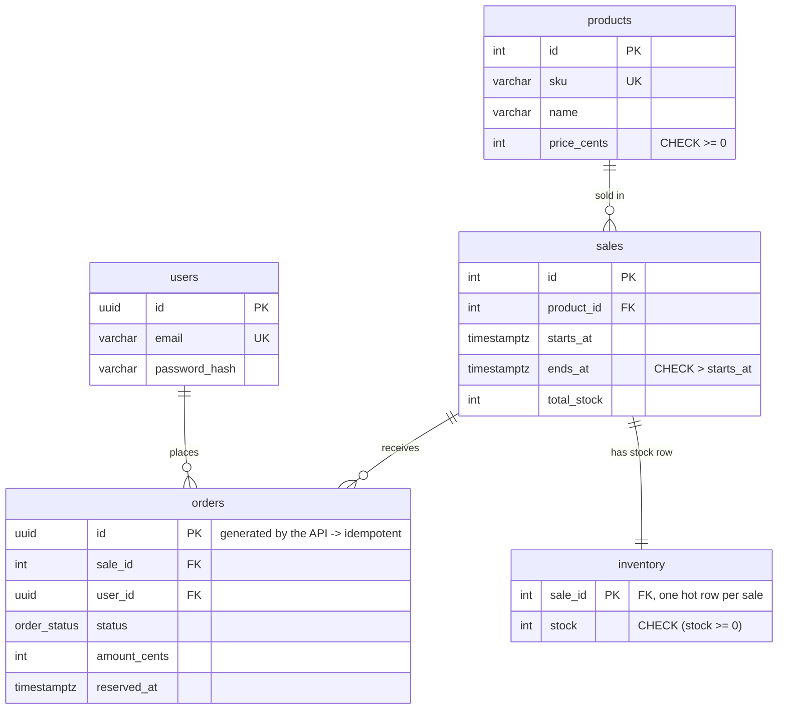

# Architecture

## Goals and constraints (from the case study)

| Layer | Constraint | Target |
|---|---|---|
| Client | stop click spam; wait/fail gracefully without freezing | bundle < 200 KB, TTI < 1.5 s |
| Gateway | ingest the spike without drops; block bots; spread load | rate-limit bad actors, 0% dropped |
| Application | decouple heavy writes from request/response; high concurrency | stateless, event-loop safe |
| Database | exactly 500 sold; no app-level counters, no row-lock timeouts | ACID, atomic decrements |

## Components

| Component | Role | Scales by |
|---|---|---|
| **React SPA** | locked Buy flow, live stock, order tracking | CDN |
| **CloudFront + WAF** (AWS) / **NGINX** (local) | TLS, static assets, rate limits, bot filtering, load balancing, 1 s status micro-cache | managed / NGINX workers |
| **API** (FastAPI, uvicorn + uvloop) | auth, checkout admission, status, SSE, order lookups | stateless replicas (ECS tasks) |
| **Redis** | inventory token, buyer set, rate-limit windows, order status | vertical; hash-tagged keys are cluster-ready |
| **RabbitMQ** | durable hand-off of reserved orders; retry and dead-letter queues | broker size / cluster |
| **Worker** | persists orders with the conditional UPDATE | replicas × prefetch |
| **PostgreSQL** | source of truth for orders and stock | vertical (it only sees ≤ stock writes) |

### Request paths

| Endpoint | Hot-path cost | Notes |
|---|---|---|
| `POST /api/v1/sales/{id}/checkout` | 2 Redis round trips + 1 broker confirm (winners only) | 1 Redis round trip after sell-out (see below) |
| `GET /api/v1/sales/{id}/status` | ~0 (edge cache, 1 s) | `proxy_cache_lock` / CloudFront collapse misses |
| `GET /api/v1/sales/{id}/events` | one in-memory queue per stream | one Redis read per process per 500 ms, regardless of stream count |
| `GET /api/v1/orders/{id}` | 1 Redis read | PostgreSQL only on a cache miss or a stale `PENDING` |
| `GET /api/v1/orders` | 1 SQL query (joined) | |
| `GET /api/v1/time` | none | clock sync for the countdown |

### Data model

`orders` has a **partial unique index** `(sale_id, user_id) WHERE status = 'CONFIRMED'`: one
successful purchase per user per sale, enforced by the database.

### Redis keys

| Key | Type | Written by | Purpose |
|---|---|---|---|
| `sale:{id}:stock` | integer | prime / `reserve.lua` / `release.lua` | reservable units |
| `sale:{id}:buyers` | hash user → order | `reserve.lua` | one reservation per user; idempotent repeats |
| `sale:{id}:meta` | hash | prime | `starts_at_ms`, `ends_at_ms` for the Lua window check |
| `order:{uuid}` | hash | API (PENDING), worker (final) | fast tracking-URL answers, 24 h TTL |
| `rl:{group}:{scope}:{identity}` | sorted set | `rate_limit.lua` | sliding-window logs |

`{id}` is a Redis Cluster **hash tag**: all keys a script touches live in one slot, so the scripts run
unchanged on cluster-mode Redis. Redis runs with `maxmemory-policy noeviction` (locally and on
ElastiCache): the token must never be silently evicted.

## Failure modes

| Failure | Behaviour | Why it is safe |
|---|---|---|
| Redis restarts empty | first checkout gets `NOT_INITIALISED` → API re-primes from PostgreSQL with `SET NX` and retries | over-admission is possible only for in-flight orders, and the DB guard rejects them (`REJECTED_SOLD_OUT`) |
| Broker unreachable / publish not confirmed | API releases the reservation (`release.lua`), marks the order `FAILED`, answers `503 Retry-After` | the client retries with jitter; the unit goes back on sale |
| Ambiguous publish (broker stored it, confirm lost) | as above, but the worker later persists it | DB guard prevents oversell; at worst the user sees `CONFIRMED` after a `FAILED` flash |
| API crashes between reserve and publish | the token leaks (undersell, never oversell) | `POST /admin/sales/{id}/reconcile` copies DB stock back to Redis once the queue is drained |
| Worker crashes after COMMIT, before ACK | message redelivered | insert-first idempotency: replay is a no-op |
| Transient DB error | message re-published to a TTL retry queue (2 s), up to 5 attempts | `persist_order` is idempotent |
| Permanent error / poison message | dead-lettered to `flashsale.orders.dlq`, unit released, user told `FAILED` | DLQ alarm on AWS |
| Hot inventory row | only the worker writes it, ≤ stock times, one statement, short transaction | no `FOR UPDATE`; `lock_timeout=2s`, `statement_timeout=5s` fail fast |
| Thundering herd at 8:00:00 | per-process single-flight sale cache; 1 s edge micro-cache with request collapsing; jittered client retries/polls | |
| SSE capacity per process | above `SSE_MAX_CONNECTIONS_PER_PROCESS` the API returns 503 → client polls the cached status endpoint | |
| Spot interruption / deploy | worker: SIGTERM → stop consuming → drain in-flight → exit; unacked messages are redelivered | |

## N+1 and other bottlenecks

The scorecard asks to *identify* the N+1 and row-lock bottlenecks. In this design:

- **N+1 queries.** The classic form here is listing a user's orders and lazily loading each
  order's sale and product: 1 + 2N queries. `GET /orders` is a single joined `SELECT`. All ORM
  relationships are declared `lazy="raise"`, so an accidental lazy load raises in tests instead of
  silently issuing a query per row. The per-request N+1 equivalent — *every* request reading the
  sale from the DB — is removed by the per-process `SaleCache` (5 s TTL, single-flight on miss).
- **Row locks.** In the trial runs every request competed for the single `inventory` row. Here the
  Redis gate admits at most `stock` requests to the queue, so the row sees ≈ 500 short, single-statement
  updates instead of 100k contended transactions. [concurrency.md](concurrency.md) shows the
  measured difference.
- **Synchronous writes in the request path.** Persisting is moved to workers behind RabbitMQ; the API
  answers `202` in milliseconds.
- **Event-loop stalls.** Only async drivers (asyncpg, redis.asyncio, aio-pika); bcrypt runs in the
  threadpool; dependencies are `async def` (a plain `def` dependency costs a thread hop per request —
  found by profiling, see [performance.md](performance.md)).

## Observability

- **Logs:** one JSON line per request (`request_id`, route, status, duration) and per processed order.
  The request id is generated at the edge (`$request_id`), accepted via `X-Request-ID`, put on the
  RabbitMQ message as `correlation_id` and re-bound in the worker. One checkout can be traced end to end.
- **Metrics:** `/metrics` on the API and `:9100/metrics` on workers. These cover RED metrics per route,
  checkout outcomes, rate-limit hits, SSE connections, Redis stock, worker outcomes, DB transaction
  time, queue lag, retries and DLQ. Run `make observability` for Prometheus and a provisioned Grafana
  dashboard.
- **AWS:** CloudWatch logs per service, Container Insights, alarms on ALB 5xx, p95 latency, DLQ depth
  and RDS CPU; WAF metrics per rule.

## Security

- JWT (HS256, short-lived) verified without I/O. Passwords use bcrypt, with constant-time behaviour
  for unknown emails.
- Admin endpoints require `X-Admin-Key` (constant-time compare). Production refuses to boot with
  default secrets.
- The real client IP is taken from `X-Forwarded-For` **N hops from the right**: 1 behind NGINX,
  2 behind CloudFront → ALB. Client-supplied entries are ignored, so they can't spoof rate limits.
- AWS: only CloudFront can reach the ALB (managed prefix list + secret origin header). Data stores
  sit in private subnets, reachable only from the task security group. TLS is enforced to RDS
  (`rds.force_ssl`), ElastiCache (in-transit encryption + AUTH) and Amazon MQ (AMQPS). Secrets live
  in Secrets Manager. The S3 bucket is private (OAC).
- NGINX: security headers and CSP, `client_max_body_size 16k`, slowloris timeouts, JSON error
  bodies.
