# AWS deployment

## TL;DR

```bash
aws sts get-caller-identity      # any authenticated CLI session (profile, SSO, env vars)
./scripts/deploy.sh              # provision + build + migrate + publish (≈ 20 min first time)
./scripts/destroy.sh             # remove everything (asks for confirmation)
```

Prerequisites: **AWS CLI v2**, **Docker** (running), **Terraform ≥ 1.10**, git, curl. You do not
need Node, Python or jq. Images and the SPA are built in Docker.

Options and environment:

| | |
|---|---|
| `AWS_REGION` | default: your CLI region, else `us-east-1`. `ap-south-1` (Mumbai) is closest to Indian shoppers |
| `PROJECT_NAME`, `ENVIRONMENT` | default `flashsale`, `dev`. Resources are named `flashsale-dev-*` |
| `CPU_ARCHITECTURE=ARM64` | Graviton tasks (≈ 20% cheaper); building needs Docker buildx/QEMU on x86 hosts |
| `./scripts/deploy.sh --plan` | show the Terraform plan only |
| `--skip-image` / `--skip-frontend` | redeploy infra or SPA without rebuilding the image |
| `--confirm` | interactive approval instead of auto-approve |
| `infra/terraform/terraform.tfvars` | every Terraform variable (copy `terraform.tfvars.example`) |

## What deploy.sh does

```mermaid
flowchart LR
    A[preflight<br/>aws/docker/terraform] --> B[state bucket<br/>versioned, encrypted]
    B --> C[terraform init<br/>S3 backend, lockfile]
    C --> D[apply ECR]
    D --> E[docker build + push<br/>tag = git SHA]
    E --> F[terraform apply]
    F --> G[run-task migrate<br/>alembic + seed]
    G --> H[SPA build →<br/>S3 + invalidation]
    H --> I[wait services-stable]
    I --> J[smoke test<br/>via CloudFront]
```



- Image tags are the git SHA (`-dirty-<timestamp>` with uncommitted changes), so rollbacks are a
  re-deploy of an older commit.
- ECS rolling deploys use a **circuit breaker with automatic rollback**.
- Migrations run as a one-off Fargate task with the same image and secrets. Alembic takes a Postgres
  advisory lock, so concurrent deploys cannot run migrations twice. API tasks boot before the first
  migration has run (startup priming is best-effort and checkout re-primes on demand).

## Architecture on AWS

| Concern | Resource |
|---|---|
| Edge | CloudFront (HTTP/2+3, Brotli), WAFv2 in us-east-1 |
| Static SPA | private S3 bucket with Origin Access Control; CloudFront Function rewrites SPA routes to `/index.html` |
| API routing | `/api/*` → ALB (no cache; `Authorization` forwarded via cache-key policy); `/api/v1/sales/*/status` → 1 s edge cache |
| Origin protection | ALB SG allows only the CloudFront origin-facing prefix list; listener requires a secret `X-Origin-Verify` header (else 403) |
| Compute | ECS Fargate: `api` (behind ALB, least-outstanding-requests), `worker` (Spot + 1 on-demand base), `migrate` (one-off) |
| Scaling | API: target tracking on CPU 55% **and** ALB requests per target. Worker: CPU + step scaling on Amazon MQ queue depth. **Scheduled pre-warm** for the sale window |
| Data | RDS PostgreSQL 16 (gp3, encrypted, TLS forced), ElastiCache Redis 7.1 (TLS + AUTH, `noeviction`), Amazon MQ RabbitMQ 3.13 (AMQPS) |
| Secrets | one Secrets Manager secret (`DATABASE_URL`, `REDIS_URL`, `RABBITMQ_URL`, `JWT_SECRET`, `ADMIN_API_KEY`) injected by ECS |
| Network | VPC across 2 AZs, private subnets + single NAT (toggle), free S3 gateway endpoint |
| Ops | CloudWatch logs per service (14 days), Container Insights, alarms (ALB 5xx, p95 > 500 ms, DLQ > 0, RDS CPU), optional SNS email |

## Preparing for the 8:00 PM sale

Reactive autoscaling takes minutes; the spike lasts ten seconds. Pre-warm:

```hcl
# infra/terraform/terraform.tfvars
prewarm_schedules = [
  { name = "sale-start", schedule = "at(2026-11-01T19:50:00)", api_min = 16, api_max = 30, worker_min = 3, worker_max = 6 },
  { name = "sale-end",   schedule = "at(2026-11-01T21:00:00)", api_min = 2,  api_max = 10, worker_min = 1, worker_max = 4 },
]
```

Then `./scripts/deploy.sh --skip-image`. Times use `Asia/Kolkata` by default (`timezone` per entry).

Also consider:

- `api.requests_per_target` and `api.max_count` (see the capacity math in [performance.md](performance.md));
- ALB pre-warming / LCU reservation through AWS for very large events;
- `enable_bot_control = true` and tighter `waf_checkout_rate_limit_per_ip` on the day;
- open the sale and run `./scripts/reset-sale.sh` against a staging stack first.

## Running the demo on AWS

```bash
APP_URL=$(terraform -chdir=infra/terraform output -raw app_url)
ADMIN_API_KEY=$(aws secretsmanager get-secret-value \
  --secret-id "$(terraform -chdir=infra/terraform output -raw app_secret_arn)" \
  --query SecretString --output text | python3 -c 'import json,sys; print(json.load(sys.stdin)["ADMIN_API_KEY"])')
BASE_URL=$APP_URL ADMIN_API_KEY=$ADMIN_API_KEY ./scripts/reset-sale.sh --stock 500 --starts-in 300
```

Logs: `aws logs tail /ecs/flashsale-dev/api --follow` (also `worker`, `migrate`). Shell into a task:
`aws ecs execute-command --cluster flashsale-dev --task <id> --container api --interactive --command sh`.

## Cost (approximate, us-east-1, on-demand, while running)

Prices change. Check the AWS Pricing Calculator. These are rough monthly figures for the defaults.

| Item | ≈ $/month |
|---|---|
| NAT gateway (1) + data | 33+ |
| ALB | 17+ |
| Fargate: 2 × api (0.5 vCPU / 1 GB) | 36 |
| Fargate: 1 × worker (0.25 vCPU / 0.5 GB) | 9 |
| RDS db.t4g.micro + 20 GB gp3 | 15 |
| ElastiCache cache.t4g.micro | 12 |
| Amazon MQ mq.t3.micro (single instance) | 25–30 |
| WAF (ACL + 5 rules) + requests | 10+ |
| CloudFront, S3, Secrets Manager, CloudWatch | a few |
| **Total** | **≈ $160–180** |

Cheaper demo settings:

- `enable_nat_gateway = false` saves about $33. Tasks get public IPs in public subnets and are
  still locked down by security groups.
- `rabbitmq_external_url = "amqps://…"` (CloudAMQP free plan) saves about $25–30. See
  [PLATFORMS.md](PLATFORMS.md).
- `CPU_ARCHITECTURE=ARM64` makes Fargate about 20% cheaper.
- `enable_waf = false` for a private demo (not recommended for a real sale).
- **Destroy when done:** `./scripts/destroy.sh` (add `--purge-state` to remove the state bucket).

New AWS accounts (since July 2025) start on a credit-based Free Tier: up to $200 of credits on a
6-month free plan. A short-lived demo of this stack fits comfortably within that.

## Production hardening checklist

- [ ] Custom domain + ACM certificate on CloudFront, and HTTPS from CloudFront to the ALB (or
      CloudFront VPC origins with an internal ALB). Today the CloudFront → ALB hop is HTTP,
      protected by the origin secret header.
- [ ] `db.multi_az = true`, `deletion_protection = true`, `skip_final_snapshot = false`, longer backups.
- [ ] `redis.num_nodes = 2` (automatic failover), Amazon MQ cluster deployment (3 nodes, quorum queues: `RABBITMQ_QUEUE_TYPE=quorum`).
- [ ] One NAT gateway per AZ.
- [ ] RDS Proxy if API task counts grow large (connection fan-in).
- [ ] WAF logging to S3/Firehose; Bot Control "targeted" inspection level for high-value sales.
- [ ] Rotate `JWT_SECRET` / `ADMIN_API_KEY` (Secrets Manager rotation), and move the admin API behind SSO.
- [ ] Remote state in a dedicated, locked-down account.
